<a id="T_TOP"></a>

# "SimBiology Modularity" Workshop Guide

In this workshop, you will build a modular representation of the ADC Bystander model (Wood, N., et. al. 2025) by:

-  developing a repository of reusable, tested models 
-  assembling a hierarchical model from submodels
-  validating the model against a known reference 

This workshop uses the SimBiology Model Builder and Model Analyzer apps. For the equivalent command-line steps, see the live script [`WorkshopGuide_CommandLine.m`](WorkshopGuide_CommandLine.m): each of its sections matches a section of this guide, and you can run it on its own.

<!-- Begin Toc -->

## Table of Contents
&emsp;[1.0 Introduction](#H_INTRO)
 
&emsp;&emsp;[1.1 Overview of Modularity](#H_INTRO_MODULARITY)
 
&emsp;&emsp;[1.2 Getting started](#H_INTRO_START)
 
&emsp;&emsp;[1.3 Overview of ADC Bystander models](#H_INTRO_OVERVIEW)
 
&emsp;&emsp;[1.4 Preview of the assembled model](#H_INTRO_PREVIEW)
 
&emsp;[2.0 Developing reusable models](#H_REUSE)
 
&emsp;[3.0 Composing submodels](#H_COMPOSE)
 
&emsp;[4.0 Assembling a complex hierarchical model](#H_ASSEMBLE)
 
&emsp;[5.0 Validation against a known reference](#H_VALIDATE)
 
&emsp;[6.0 Extending a hierarchical model](#H_EXTEND)
 
&emsp;[Appendix A: Hierarchical SimBiology model](#H_APPENDIX_HIERARCHY)
 
<!-- End Toc -->
<a id="H_INTRO"></a>

# 1.0 Introduction

<a id="H_INTRO_MODULARITY"></a>

## 1.1 Overview of Modularity

SimBiology models can be structured as a hierarchy of self-contained **submodels**, each a complete, independently simulatable model. The dynamics of the submodels in a hierarchy are coupled through **equivalence sets** of quantity components in different submodels that all represent the same state.

Using submodels for modular modeling workflows enables:
- organization of complex models with submodels that focus on one process, cell type or environment at a time
- development of submodels in parallel
- reuse of reviewed and tested models

<a id="H_INTRO_START"></a>

## 1.2 Getting started

### 1.2.1 Starting MATLAB Online

-  Follow the link provided during the workshop to login to MATLAB Online with a trial license.

<a id="H_INTRO_GIT"></a>

### 1.2.2 Syncing the git repo

The workshop files are distributed as a **Git repository**.

1. In MATLAB, select **Home > New > Git Clone**. *(Alternatively, from the Current Folder browser, right-click > **Source Control > Manage Files** and clone.)*
2. Enter the workshop repository URL, `https://github.com/priyamoorthy-mw/simbio-modularity-workshop.git`, and click **Clone**.
3. MATLAB copies the workshop repository into your working folder.


<p align="center">
  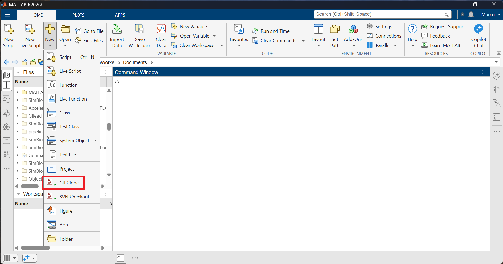
  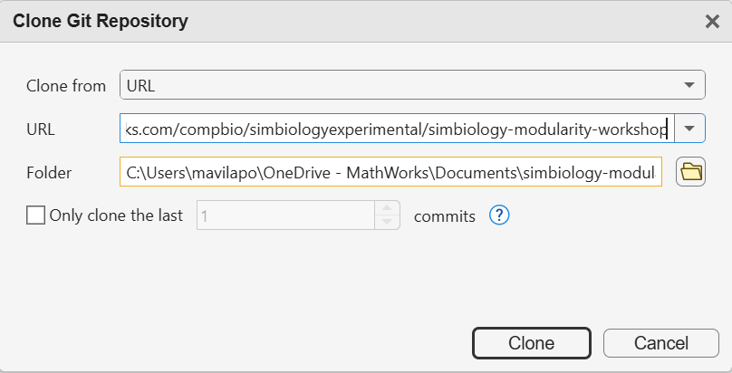
  <br>
  <em>Figure 1. Cloning the workshop repository: Home &gt; New &gt; Git Clone (left) and the Clone Git Repository dialog (right).</em>
</p>

<a id="H_INTRO_REPO"></a>

### 1.2.3 Repository overview

The repository is organized to mimic a modular development workflow where reusable models are developed and tested in a dev environment and, once validated, promoted to a shared model repository from which they can be reused.

| Folder | Purpose |
|---|---|
| `ModelRepository/` | Completed and tested models for reuse stored in sbproj files. Every model has a corresponding test in the `tests` folder within ModelRepository, locking down any structural or dynamic behavior that the model author guarantees for a downstream user. These sbproj files serve as sources for importing submodels into other SimBiology projects. |
| `dev/` | Our development environment, where we create new models. Work you do during the workshop will go in here. |
| `data/` | Datasets, such as reference data for testing. |
| `dev/assembled` | Contains projects that have been saved at intermediate states of completion for this workshop. |


All file paths in this guide are relative to the repository root.

<a id="H_INTRO_OVERVIEW"></a>

## 1.3 Overview of ADC Bystander models

### 1.3.1 Conceptual pharmacology

The model in this workshop is based on the antibody–drug conjugate (ADC) bystander models published by Wood et al. (2025) [[1]](#REF_WOOD2025). The paper studies how an ADC's payload kills both the cells that express the target antigen (Ag+) and neighboring cells that do not (Ag-).

<p align="center">
  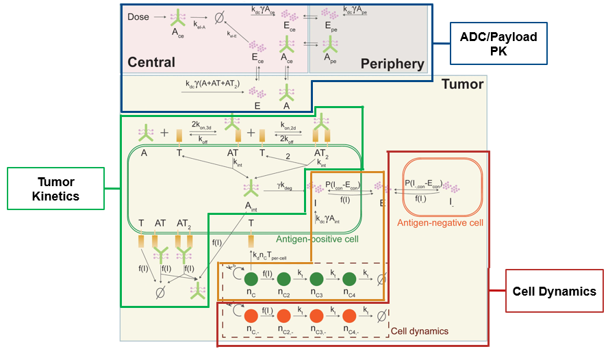
  <br>
  <em>Modified from [1].</em>
</p>

#### Payload-mediated cell death

Antibody that binds a target expressed on tumor cells is conjugated to a payload (drug). The payload affects tumor cell death in two possible ways:

-  **Direct killing:** the ADC binds its target on antigen-positive cells and is internalized, releasing the payload inside the cell.
-  **Bystander killing:** free payload diffuses into nearby cells, including Ag- tumor cells that do not bind the target.

#### Cell populations

The tumor itself is composed of a mixed population of cells that may be:
- Antigen positive or antigen negative (binds or does not bind the antibody)
- Independently growing (tumor) or recruited by tumor cells (stroma)

#### Model scenarios

The paper compares three distributions of cell populations:

| Scenario | Cell populations |
|---|---|
| One-Cell Type Model | Ag+ tumor cells only |
| Independent Growth Bystander Model | Independently growing Ag+ and Ag- tumor cells |
| Recruitment Bystander Model | Recruited Ag+ stroma cells and independently growing Ag- tumor cells |

#### The SimBiology model
The SimBiology hierarchical model supports any ratio of the different cell populations, including the three orginal scenarios from the paper.


#### References

<a id="REF_WOOD2025"></a>
1. Wood NE, Cengiz A, Gao M, Ratushny AV, Straube R. Mechanistic modeling suggests stroma-targeting antibody-drug conjugates as an alternative to cancer-targeting in cases of heterogeneous target expression. *PLoS Comput Biol.* 2025;21(8):e1012839. [https://doi.org/10.1371/journal.pcbi.1012839](https://doi.org/10.1371/journal.pcbi.1012839)


<a id="H_INTRO_PREVIEW"></a>

## 1.4 Preview of the assembled model

Preview the final assembled model before you begin assembling it from scratch.

1. Open `dev/assembled/ADCBystander_Assembled.sbproj` in the **SimBiology Model Builder**. In the Browser on the left-hand side, use the filter to show just the model nodes in the Project tree and explore the model hierarchy.

   <p align="center">
     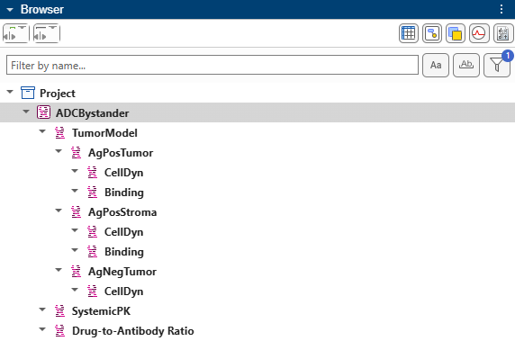
     <br>
     <em>Figure 3. The <code>ADCBystander</code> model hierarchy in the Browser, filtered to show only model nodes.</em>
   </p>

2. Walk through the hierarchy from the top down. Select a model in the Browser to highlight it in the diagram. Double-click on a submodel block in the diagram to focus on that model and see its own diagram and components table.
Tip: Close or re-tile the document tabs to see just the diagram or tables.
Tip: Use the Browser filter to choose which component types to see in the tree.

   | Model | What to look at |
   |---|---|
   | `ADCBystander` | The top-level model. It contains two major submodels - one for systemic PK and the other for tumor dynamics, and reports the total ADC between the systemic and tumor pools. It also contains a submodel that refreshes the drug to antibody ratio for each new dose. |
   | `SystemicPK` | Plasma PK of the ADC and free payload, and their delivery to the `Tumor` compartment by permeation. Also contains dose and dose parameters. |
   | `TumorModel` | Model that coordinates the aggregation and interactions between the different cell subtype populations, including total tumor volume and growth rates. |
   | `AgPosTumor`, `AgNegTumor`, `AgPosStroma` | Container models for each subtype of cell population, with a `CellDyn` submodel and optional `Binding` submodel for Ag+ cell populations. Ag- cells do not bind the ADC, so payload reaches them only by bystander diffusion. |
   | `CellDyn` | Models the dynamics - growth, payload permeation in and out of cells and the staged payload-driven death - of a given subtype's cell population. |
   | `Binding` | Models ADC binding to the target, internalization, and release of payload inside cells. |
   | `Drug-to-Antibody Ratio` |  Models a change over time for payload load per antibody change over time due to linker deconjugation. At each dose, fresh, fully loaded ADC is mixed in. |

   The [appendix](#H_APPENDIX_HIERARCHY) summarizes each submodel's role and the quantities it shares with the rest of the model.

   <p align="center">
     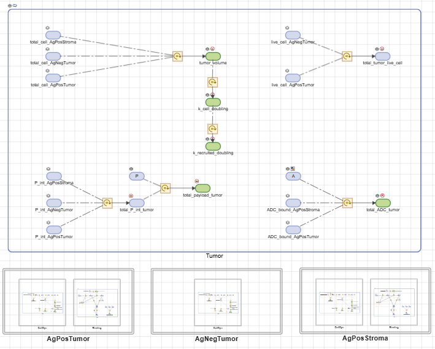
     <br>
     <em>Figure 4. <code>TumorModel</code> diagram: aggregation rules in the <code>Tumor</code> compartment, with the <code>AgPosTumor</code>, <code>AgNegTumor</code>, and <code>AgPosStroma</code> submodels below.</em>
   </p>

3. The dynamics of the submodels in a hierarchy are coupled through **equivalence sets** of quantity components in different submodels that all represent the same state. Conceptually, states will be shared between submodels if:
- *multiple submodels reference the same constant value*. For example, the `Tumor` compartment volume represents the same physical environment across all the submodels (`SystemicPK`, `TumorModel`, and each `CellDyn` and `Binding`).
- *other submodels use a value whose dynamics are determined by another submodel*. For example, each cell population determines its own total cell count and `TumorModel` computes the sum of these values. In turn, `TumorModel` computes a net tumor volume from all the cell populations, which is used by `SystemicPK` and other submodels
- *multiple submodels directly alter the dynamics of the state*. For example, `Tumor.P` represents one free extracellular payload pool, changed by reactions in several submodels: `SystemicPK` delivers it, `Binding` releases it, and each `CellDyn` takes it up into its cells.

Note that these are *conceptual* cases. All equivalence sets are treated the same and there are no restrictions on the equivalence set or quantities to enforce that a quantity is read-only.

Open the Equivalences panel to view this model's equivalence sets. Use the search bar to find the three examples from above. Note that each equivalence set must contain quantities of the same type and only one quantity per submodel. One quantity in each equivalence set is designated as the resolved quantity (shown in bold with a filled-in icon) and determines the intial value, units, constant, and representative name.

   <p align="center">
     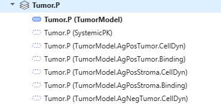
     <br>
     <em>Figure 5. The <code>Tumor.P</code> equivalence set. Note that one quantity in the set is designated as the resolved quantity; in this case, the resolved quantity is owned by <code>TumorModel</code> and is shown in bold; the other members come from <code>SystemicPK</code> and the cell-population submodels. They all represent the same physical state.</em>
   </p>

4. **(Optional)** Open the **Model Analyzer** and open Program1. There are three variants, each configuring the hierarchical model for one of the cell population setups described in the paper. Run the program to see simulation results after applying a single IV bolus dose of the drug.

   <p align="center">
     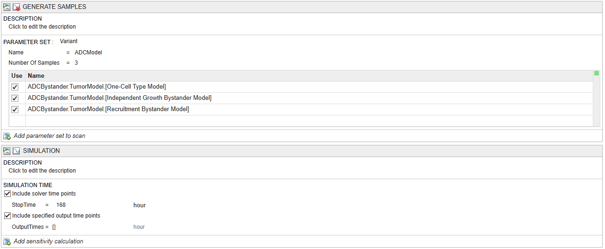
     <br>
     <em>Figure 6. Model Analyzer program: the Generate Samples step scans the three scenario variants of <code>TumorModel</code>.</em>
   </p>

   <p align="center">
     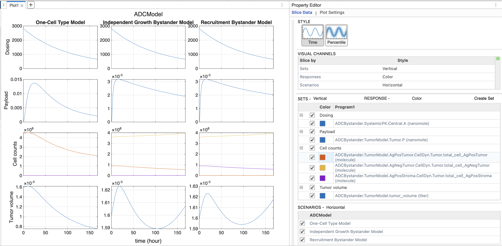
     <br>
     <em>Figure 7. Simulation results for the three scenarios: dosing, tumor volume, cell populations, and payload over one week.</em>
   </p>


<a id="H_REUSE"></a>

# 2.0 Developing reusable models

Cell populations in a tumor share common motifs: they grow, they die in stages, and a payload kills them. Likewise, ADC binding is the same for every population that expresses the target. Capturing each motif once, in a submodel, lets you reuse it for every kind of cell population (Ag+ or Ag-, tumor or stroma).

SimBiology project files can be used to create a repository of curated and tested models intended to be reused as submodels in a larger system.

Mathematically, these models are all standalone SimBiology models that can be simulated on their own. Conceptually, some states are effectively placeholders that are used to drive model dynamics but are expected to actually be computed outside the submodel. SimBiology does not enforce a formal interface to indicate modeler intent; users can develop naming and tagging conventions to share how a model is meant to be used.

**Takeaways**

-  **Encapsulation:** To be simulated on its own, a submodel must own every quantity used in its own expressions.
-  **Modular building best practice — functional decomposition:** A submodel focuses on one aspect of the system (a process, a population or a function) and leaves out the others. Some of its quantities are placeholders for values that will come from outside the submodel. Use driver variants or rules to set values for placeholder states during standalone simulation.
-  **Modular building best practice — naming conventions:** Use standard naming and tagging conventions to indicate intent, such as which components are intended to be submodel-specific states (e.g., cell count for a given population subtype) vs. which components are shared across the larger model (e.g., whole tumor volume)
-  **Validation with MATLAB unit tests:** A test locks down structure and dynamic behavior that a modeler guarantees to downstream users. It also serves as a regression test to ensure changes to a model does not break existing behavior.

## 2.1 Open `ModelRepository/GenericTumorCellModels.sbproj` and inspect the models

The project contains two flat models, `GenericCellDynamics` and `GenericBinding`, both intended to be generic models that can be reused for different cell types.

Double-click `GenericCellDynamics` to see its diagram and tables in the center panel. Select a reaction to highlight it in the diagram and show its properties in the Property Editor on the right.

<p align="center">
  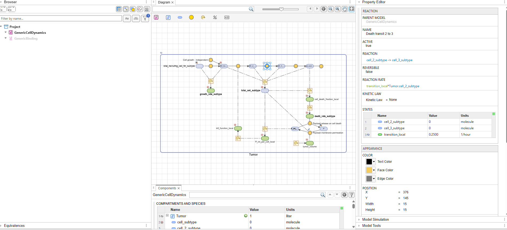
  <br>
  <em>Figure 8. <code>GenericCellDynamics</code> diagram with the reaction "Death transit 2 to 3" selected and its properties shown in the Property Editor.</em>
</p>

GenericCellDynamics` models one population of cells in the tumor, for example Ag+ tumor cells. It does not know which population it represents, so the same model can be reused for every population.

### Key components of the model

1. **Initial population size** is set by the population's cell fraction and the initial tumor cell volume (`Rule_subtype_cell_count_init`).
2. **Growth** comes from two reactions: independent growth at `k_self_doubling_for_subtype`, as tumor cells grow, and growth recruited by another population at `k_recruited_doubling_for_subtype`, as stroma cells grow ("Cell growth - independent" and "Cell growth - recruitment").
3. **Cell death is staged:** damaged cells pass through two transit stages before they die and are removed, which delays death after damage ("Death transit 2 to 3" and "Death transit 3 to death").
4. **Payload-mediated death:** free payload, `Tumor.P`, crosses into the cells, and the internalized payload, `Tumor.P_int_subtype`, sets the rate at which live cells start to die ("Payload membrane permeation" and `Rule_kill_function`).

### Naming conventions

This workshop generally assumes that quantities with the same name (or, for a species, the same compartment-qualified name) in different submodels belong in the same equivalence set. Quantities that every population shares, such as `Tumor`, `Tumor.P` and `tumor_volume`, have the same names throughout the larger system.

This generic model also has quantities specific to each population, whose names all end in the suffix `_subtype`. When you use a copy of the model for a population, you run a small parameterization script that replaces the suffix with the name of the parent model, so that each population's names are unique (Section 3.12).

### Driving placeholder states

This model describes only the growth and death of one population. Some of the quantities it uses are placeholders for values that are expected to be computed by other submodels. To simulate the model on its own, you can drive these values in one of two ways:

-  **Standalone driver variant.** The "Drivers for testing standalone model" variant sets values for placeholder quantities that can be modeled as a constant for the purposes of testing this model as a standalone. For the GenericCellDynamics model, this includes the free payload, `Tumor.P` (which will be determined by the Binding model that models payload release by deconjugation from the antibody), and, the total number of recruiting cells, `Tumor.total_recruiting_cell_for_subtype`. Apply it, with the `TumorCell` or `StromaCell` variant, which chooses whether the population grows on its own or is recruited. You can change how the model is driven by editing these variants.

-  **Standalone-only expressions.** If you want to use a time-varying value for a placeholder quantity, you can use rules or reactions that should be set as inactive in the assembled model (otherwise you end up with an overdetermined system). For example, select the parameter `tumor_volume`: the Usages section of the Property Editor shows that the "Payload membrane permeation" reaction uses it. Every quantity in an expression must be owned by the model itself, so the model has its own `tumor_volume`, even though in the full model the tumor volume depends on all the cell populations. `Rule_tumor_volume_standalone` computes the tumor volume from this population's cells alone, so the model simulates on its own. The rule is active by default; you will turn it off when you assemble the population into the Tumor Model, which computes `tumor_volume` from all the populations.

   <p align="center">
     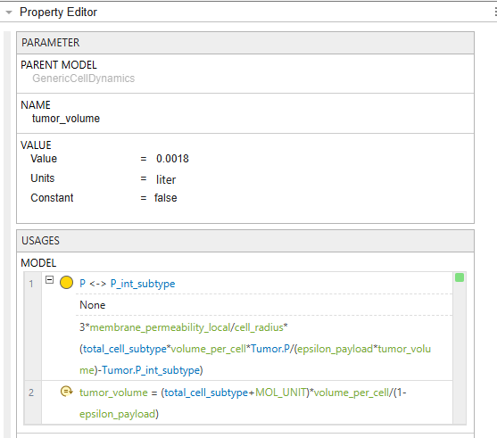
     <br>
     <em>Figure 9. Property Editor for <code>tumor_volume</code>. The Usages section lists the reaction and rule that use it.</em>
   </p>

## 2.2 **(Optional)** Simulate the generic model with different driver and configuration variants

Simulate three cases by changing which variants are active and what the driver supplies. In each case, `Rule_tumor_volume_standalone` is already active, so no other setup is needed.

| Case | Configuration variant | `Tumor.P` in the `Drivers…` variant | What to look for |
|---|---|---|---|
| Tumor cells without payload (drug) | `TumorCell` | 0 | Unchecked growth over one week (the StopTime is 168 hours). |
| Tumor cells with payload | `TumorCell` | 10 | The cell count declines. |
| Stroma cells with payload | `StromaCell` | 10 | Growth recruited by the driver's recruiting cells, instead of independent growth. |

1. Make the `TumorCell` and `Drivers for testing standalone model` variants active, and in the `Drivers…` variant, set `Tumor.P` to 0.

   <p align="center">
     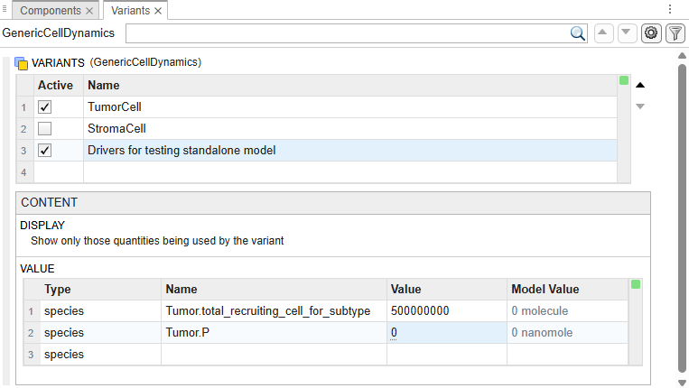
     <br>
     <em>Figure 10. Variants panel with the <code>TumorCell</code> and <code>Drivers for testing standalone model</code> variants active. The driver variant sets <code>Tumor.P</code> to 0.</em>
   </p>

2. Create a new plot in the Model Simulation tool, and add `Tumor.total_cell_subtype` to it.
3. Simulate. Note the unchecked growth over one week.

   <p align="center">
     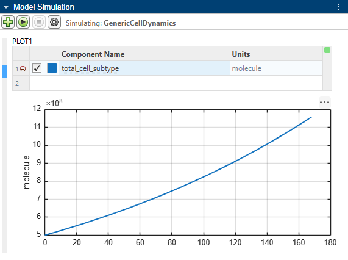
     <br>
     <em>Figure 11. Model Simulation tool plotting <code>total_cell_subtype</code>: unchecked growth over one week.</em>
   </p>

4. In the `Drivers…` variant, set `Tumor.P` to 10, and simulate again.

   The cell count declines. It does not level off or rebound, because this model does not clear the payload: payload released by dying cells returns to the tumor and enters the remaining cells.

5. Make the `StromaCell` variant active instead of `TumorCell`, and simulate again.

   The `StromaCell` variant turns off independent growth by setting its rate to 0, and turns on growth recruited by the recruiting cells that the driver supplies.

## 2.3 **(Optional)** Use MATLAB unit tests to lock down the behavior of models intended for reuse

Every model in `ModelRepository` has a test in `ModelRepository/tests` that states what the model's author guarantees about its structure and dynamics to anyone who reuses it. Each test point is named for one guarantee, so the list of results reads as the model's specification.

| Test | Model |
|---|---|
| `tGenericTumor_CellDynamics` | `GenericCellDynamics` in `GenericTumorCellModels.sbproj` |
| `tGenericTumor_Binding` | `GenericBinding` in `GenericTumorCellModels.sbproj` |
| `tCellPopulations_AgPosTumor`, `tCellPopulations_AgNegTumor`, `tCellPopulations_AgPosStroma`, `tCellPopulations_AgNegStroma` | The cell populations in `CellPopulations.sbproj` |
| `tDrugDisposition_SystemicPK` | `SystemicPK` in `DrugDispositionModels.sbproj` |
| `tDrugDisposition_DAR` | `Drug-to-Antibody Ratio` in `DrugDispositionModels.sbproj` |

1. Open the Test Browser and add `ModelRepository/tests/tGenericTumor_CellDynamics.m`. These tests verify both model structure (e.g., naming conventions and tags) and dynamics (e.g., without payload the population grows as its growth mode predicts).
2. Run the tests. If a user changes the model, they can rerun the tests to confirm that they have not changed what other people rely on. Such tests can also run as part of an automated CI/CD workflow that only commits model changes for which the test passes.

   <p align="center">
     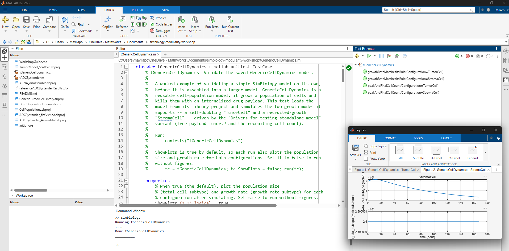
     <br>
     <em>Figure 12. Test Browser with the <code>tGenericTumor_CellDynamics</code> test points passing, and the plots the test generates.</em>
   </p>

<a id="H_COMPOSE"></a>

# 3.0 Composing submodels

Combine the dynamics of two submodels to build a population of Ag+ tumor cells whose death is driven by the ADC it binds.

**Takeaways**

-  **Hierarchical models:** A SimBiology model can own any number of child models, each a full-fledged SimBiology model that can own child models of its own. There is no limit on the number of levels.
-  **Equivalence sets:** Combine the dynamics of different submodels by specifying which quantities of the same type (compartment, species or parameter) represent the same state in the parent model's ODEs. Each model in the hierarchy can contribute at most one quantity to an equivalence set.
-  **Resolved quantity:** The member of an equivalence set that determines the Value, Units and Constant property of the state the set represents. (For a species, the compartment volume is also taken from the resolved quantity's compartment, which may itself get its value from its own equivalence set.) The resolved quantity defaults to the member from the highest model in the hierarchy or, for a tie, from the first sibling model listed in the parent's Models property. The resolved quantity must lie inside the current model's subtree, so different model contexts can have different resolved quantities.
-  **Fully qualified name (FQN):** A reference to a quantity in a hierarchical model that prefixes its name (or, for a species, its compartment-qualified name) with the dot-separated path of its ancestor models, for example `AgPosTumor.Binding.Tumor.A`.

You will create a hierarchical model of a population of Ag+ tumor cells in which the payload-mediated death in the `CellDyn` submodel is driven by the payload that the cells internalize when they bind the antibody–drug conjugate (ADC), modeled in the `Binding` submodel.

## 3.1 Create a new project with a parent model, `AgPosTumor`

1. Close the project from Section 2.0 without saving changes. An empty new project opens in the **Model Builder**.
2. Add a new blank model named `AgPosTumor` to the project, and delete its default compartment.
3. Configure the simulation settings of `AgPosTumor`:

   | Setting | Value |
   |---|---|
   | StopTime | 168 |
   | TimeUnits | hour |
   | AbsoluteTolerance | 1.0000e-10 |
   | RelativeTolerance | 1.0000e-8 |
   | DefaultSpeciesDimension | substance |

## 3.2 Import existing submodels

1. On the toolstrip, select **Model > Load Model from File…** and choose `ModelRepository/GenericTumorCellModels.sbproj`.
2. Select both the `GenericCellDynamics` and `GenericBinding` models by holding down the Shift key while selecting.

   <p align="center">
     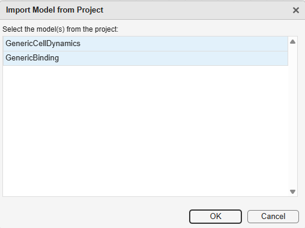
     <br>
     <em>Figure 13. Import Model from Project dialog with <code>GenericCellDynamics</code> and <code>GenericBinding</code> selected.</em>
   </p>

3. Both models are added to the project as top-level models, so the project now has three models.

## 3.3 Move the submodels into the parent model

1. In the Browser, use the filter to show only the model nodes.
2. Drag the submodel nodes onto the `AgPosTumor` node to move the models (or use the context menu).

   <p align="center">
     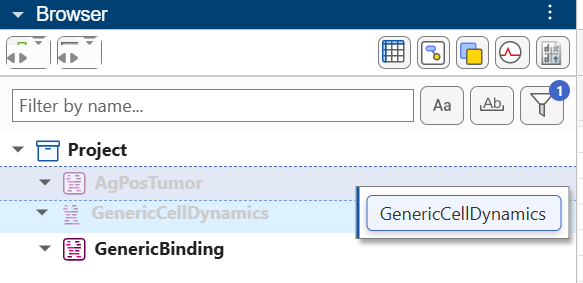
     <br>
     <em>Figure 14. Dragging <code>GenericCellDynamics</code> onto <code>AgPosTumor</code> in the Browser to make it a submodel.</em>
   </p>

   A warning tells you that the models are being removed from the project. Undo works per model, and you cannot undo adding or removing a top-level model; you can undo the move into `AgPosTumor`, which removes the submodel from the parent, but it will not restored as a top-level model. Instead move the model back to the Project node to make it a top-level model.

3. Rename `GenericCellDynamics` to `CellDyn` by clicking on the model in the Browser and then editing the name in the Property Editor.
4. Rename `GenericBinding` to `Binding` by clicking on the model in the Browser and then editing the name in the Property Editor.
5. Clear the filtering options.

## 3.4 Configure the cell dynamics submodel as a tumor cell population

1. Double-click the `CellDyn` submodel in the diagram to zoom in on it and show its components in the tables in the center panel.
2. Open the Variants panel from the Browser toolbar. Right-click "TumorCell" and select "Commit". Committing applies the TumorCell configuration to the model, whether or not the variant is active.

   <p align="center">
     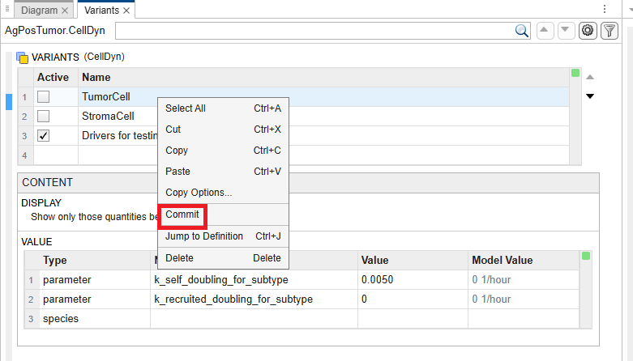
     <br>
     <em>Figure 15. Committing the <code>TumorCell</code> variant of <code>AgPosTumor.CellDyn</code> from the right-click menu.</em>
   </p>

3. Type "standalone" in the Browser filter, find `Rule_tumor_volume_standalone`, and confirm that its Active property is true: `AgPosTumor` simulates on its own until it is assembled into the Tumor Model. Clear the filter afterward.

## 3.5 Create the driver variant for `AgPosTumor`

When you simulate in the Model Builder, only the active variants that the simulated model itself owns are applied, so `AgPosTumor` needs its own driver variant.

1. Double-click on `AgPosTumor` in the Browser to make it the current model.
2. Open the Variants panel and add a new variant to `AgPosTumor` named "Drivers for testing standalone model".
3. Add a row for `AgPosTumor.Binding.Tumor.A`, and set its Value to 1.

   <p align="center">
     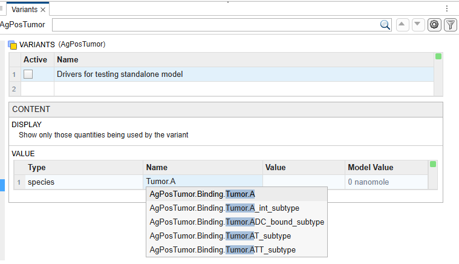
     <br>
     <em>Figure 16. Adding a variant entry: the Name dropdown suggests fully qualified names such as <code>AgPosTumor.Binding.Tumor.A</code>.</em>

   </p>

   The free extracellular ADC, `Tumor.A`, is the only input that comes from outside `AgPosTumor` (from `SystemicPK`, once the model is assembled). You no longer need to set `Tumor.P` in the driver variant, because `CellDyn`'s `Tumor.P` will be driven by the payload that `Binding` releases. The other quantities that `Binding` uses but does not compute (`total_cell_subtype`, `growth_rate_subtype`, `death_rate_subtype` and `tumor_volume`) will come from `CellDyn` once the equivalences are matched.

4. Make the driver variant active.

## 3.6 Plot the total cell count

In the Model Simulation tool, create a new plot and add `AgPosTumor.CellDyn.Tumor.total_cell_subtype`.

## 3.7 Simulate the hierarchical parent model

The Model Builder applies the active variants of the simulated model (`AgPosTumor`), but not those of its submodels (just like `sbiosimulate` does at the command line). (Use the Model Analyzer to apply the variants of submodels.) Note that the tumor grows unchecked even though `Tumor.A` is set to 1, because the submodels are not connected yet.

## 3.8 Match equivalences

1. Open the Equivalences panel.
2. Click Auto-match and check that Match by "name" is selected.

   <p align="center">
     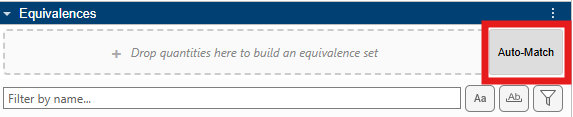
     <br>
     <em>Figure 17. The Auto-Match button in the Equivalences panel.</em>
   </p>

   Auto-match proposes an equivalence set for each group of quantities with the same qualified name: the name of a compartment or parameter, or the compartment-qualified name of a species.

3. Review the proposed sets and their resolved quantities, then accept all of them.

   Inspect each proposed set to confirm that it represents the same dynamic state or constant in both models. Each resolved quantity defaults to the first sibling model, `CellDyn`. Any quantity in an equivalence set can serve as its resolved quantity: it determines the initial value, units, Constant property, and the name of the shared state in the ODEs and in the states to log. In practice, when one submodel changes a state and the others only use it, choosing the resolved quantity from the submodel that changes it can clarify intent. In this case, the default makes sense, because `CellDyn` is the core submodel and `Binding` just adds functionality on top of the cells' growth, death and payload permeation.

   <p align="center">
     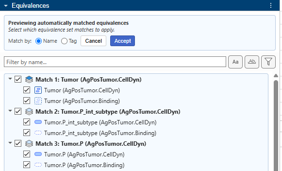
     <br>
     <em>Figure 18. Auto-match preview, matching by name. Each proposed set lists its members; the set title names the resolved quantity.</em>
   </p>

   After you accept them, the new equivalence sets appear under `AgPosTumor` in the Equivalences panel.

   <p align="center">
     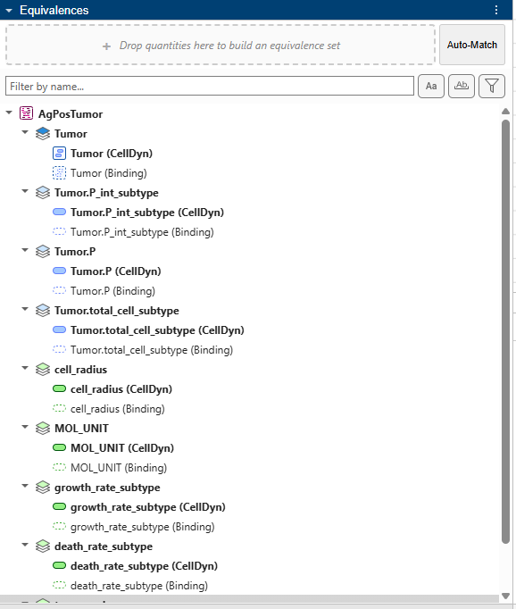
     <br>
     <em>Figure 19. Accepted equivalence sets under <code>AgPosTumor</code>. Each resolved quantity (bold) comes from <code>CellDyn</code>.</em>
   </p>

## 3.9 Simulate the hierarchical parent model again

In the Model Simulation tool, simulate again. The cell count now drops over time because the payload levels in `CellDyn` is being driven by the `Binding` model.

## 3.10 Simulate `CellDyn` in isolation

1. Find the node for the `CellDyn` submodel, right-click it and select "Set as current model".
   `CellDyn` is now treated as a standalone model: it is the model the Simulation tool simulates, its initial conditions are the ones shown, and each equivalence set uses a resolved quantity from inside `CellDyn` (the resolved quantity in the parent model might not be in this submodel's subtree). Components outside `CellDyn` are grayed out in the Browser and Equivalences panels.
2. Inspect the Equivalences panel. The resolved quantities have changed with the current model, because a resolved quantity must lie inside the current model's subtree.
3. Open the Variants panel. Set `Tumor.P` to 0 in the `Drivers…` variant and that the variant is active to drive the submodel without any payload.
4. Run the Simulation tool.

   The curve is the same as the one from simulating `GenericCellDynamics` with no payload on its own in Step 2.

## 3.11 Simulate the parent model again

The equivalence sets keep their connections when you simulate a submodel in isolation.

1. Double-click `AgPosTumor` to make it the current model. (Double-clicking any grayed node makes its top-level model the current model.)
2. Run the Model Simulation tool again, and note that the cell count drops again.

## 3.12 Parameterize the population

The names of the quantities specific to this population still end in `_subtype`, as in the generic models. To use automatic matching by name, a tumor model with several populations needs each population's quantities to have names of their own, so that, for example, `AgPosTumor`'s cell count does not connect by name to to `AgNegTumor`'s cell count. We will use a small script to automatically parameterize this model and replace all instances of the suffix `_subtype` with the model name.

1. In the **Model Builder** browser panel, right-click `AgPosTumor` and select **Export Model to Workspace**. Export it as `m1`.

   Any model open in the apps can be exported to the MATLAB workspace and changed at the command line while it is still open in the app. Changes made to the model at the command line will automatically be reflected in the app.

2. Switch to the MATLAB Command Window (by collapsing the Builder App window), and run:

   ```matlab
   addpath ModelRepository/tools
   parameterizeModel(m1, "subtype")
   ```

   `parameterizeModel` renames every component of `AgPosTumor` and its submodels whose name ends in `_subtype`, replacing the suffix with the model's name: e.g., `CellDyn.Tumor.total_cell_subtype` becomes `CellDyn.Tumor.total_cell_AgPosTumor`.

3. Switch back to the Model Builder app (by expanding the collapsed window). In the Browser, search for "AgPosTumor" to see the renamed quantities.

The cell populations in `ModelRepository/CellPopulations.sbproj`, which you use in the next section, were built and parameterized the same way.

<a id="H_ASSEMBLE"></a>

# 4.0 Assembling a complex hierarchical model

Combine PK and PD for ADC-mediated cell death, beginning with a single case, a uniform population of Ag+ tumor cells, but with hooks to extend it to heterogeneous cell populations.

## 4.1 Construct a Tumor Model that aggregates multiple cell population types

1. Open `dev/TumorModel_Scaffold.sbproj`, and save it as `dev/ADC_Workshop.sbproj`.
2. Inspect the species and rules.

   This model is a coordination layer for a tumor with heterogeneous cell populations. Initially, it has a single cell population, Ag+ tumor cells. Its rules aggregate quantities from the cell populations, so that more populations can be added later. Its placeholders for the population are named for it: `Tumor.total_cell_AgPosTumor`, `Tumor.live_cell_AgPosTumor` and `cell_fraction_AgPosTumor`.

3. Select **Model > Load Model from File…**, choose `ModelRepository/CellPopulations.sbproj`, and select `AgPosTumor`. Move `AgPosTumor` into `TumorModel`.

   `CellPopulations.sbproj` has four cell populations, `AgPosTumor`, `AgNegTumor`, `AgPosStroma` and `AgNegStroma`, built and parameterized like the `AgPosTumor` model you constructed. Every population has the same model tree: a container model with a `CellDyn` submodel (a copy of `GenericCellDynamics`), and, for the Ag+ populations, a `Binding` submodel (a copy of `GenericBinding`). As in `GenericCellDynamics`, each `CellDyn` has `Rule_tumor_volume_standalone` active, so every population simulates on its own.

4. Add `TumorModel`'s cell count to the existing equivalence set for `AgPosTumor`'s cell count, by hand.

   `AgPosTumor`'s `CellDyn` and `Binding` already share `Tumor.total_cell_AgPosTumor` in an equivalence set under `AgPosTumor`. Type "total_cell" in the Equivalences panel's search bar to find it. In the Browser, search for "total_cell_AgPosTumor", and drag `TumorModel`'s `Tumor.total_cell_AgPosTumor` onto the existing set in the Equivalences panel.

   <p align="center">
     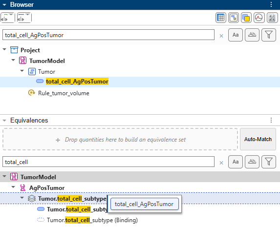
     <br>
     <em>Figure 20. Adding a quantity to an existing set by hand: dragging <code>total_cell_AgPosTumor</code> from the Browser onto an existing set in the Equivalences panel.</em>
   </p>

   An equivalence set is shown under the lowest model that contains all its members: the set for `Tumor.total_cell_AgPosTumor` moves from `AgPosTumor` to `TumorModel`, because it now has a member from `TumorModel`. To see a flat list instead, open the filter and clear "Group by lowest common model".

   Adding a quantity to an existing set does not change the set's resolved quantity, so it is still `AgPosTumor.CellDyn`'s `total_cell_AgPosTumor`. That is what you want: `CellDyn` owns the growth and death of the cells, and `TumorModel` only sums them.

5. Connect the growth rate manually.

   `TumorModel` computes one tumor-wide, density-limited (Gompertz) growth rate, `k_cell_doubling`, for every tumor population, and each population's submodel has two growth rates - one for independent growth and the other for recruited growth, so the growth rate names do not match by name. Connect them manually. In the Browser, select `k_cell_doubling` and `AgPosTumor.CellDyn.k_self_doubling_for_AgPosTumor`, right-click, and select Create New Equivalence Set. (Alternatively, drag both into the drop zone at the top of the Equivalences panel and click Create.) Keep `TumorModel` as the resolved quantity: `Rule_k_cell_doubling` computes the rate from the whole tumor's volume.

6. Auto-match by name to connect everything else, and review the proposals.

   Every proposal is a true match: the shared states and constants (`Tumor`, `Tumor.P`, `Tumor.A`, `tumor_volume`, `cell_radius`, and so on), and `AgPosTumor`'s live cell count and cell fraction, which have the same names as their placeholders in `TumorModel`. Where a proposal includes quantities that are already in a set, such as `Tumor.P`, which `AgPosTumor`'s `CellDyn` and `Binding` already share, accepting it adds the new members to that set, and the set keeps its resolved quantity. For a new set, the resolved quantity defaults to the member from the highest model, `TumorModel`.

   Set these resolved quantities, then accept all of the proposals.

   | Equivalence set | Set resolved quantity to | Why |
   |---|---|---|
   | `Tumor`, `Tumor.P`, `tumor_volume`, `cell_radius`, `MOL_UNIT` | `TumorModel` | These sets already existed in `AgPosTumor`, so they are still resolved in `CellDyn`. `TumorModel` computes `tumor_volume` and `cell_radius` from all the populations, and owns the states shared across the tumor. |
   | `Tumor.live_cell_AgPosTumor` | `AgPosTumor.CellDyn` | As for the total cell count, `CellDyn` owns the dynamics of the live (stage 1) cells. |
   | `cell_fraction_AgPosTumor` | `TumorModel` (default) | `TumorModel` seeds the population mix; the scenario variants will set the fractions on `TumorModel`. |

   To change a resolved quantity, right-click the quantity in the auto-match panel and select "Set as Resolved Quantity".

7. Disable `Rule_tumor_volume_standalone` in `AgPosTumor.CellDyn`, because `TumorModel` now computes `tumor_volume` by selecting the rule in the browser and setting Active to `false` in the Property Editor.

   *(Optional)* To see why, leave it active and click Verify. Verification fails because the system is overdetermined: two assignment rules (`TumorModel`'s and the `TumorModel.AgPosTumor.CellDyn`) set the same state.

   > Invalid repeatedAssignment 'Rule_tumor_volume_standalone' in model 'TumorModel.AgPosTumor.CellDyn'. The resolved quantity 'TumorModel.tumor_volume' is specified by more than one assignment rule.

   Stand-in rules like this one let a submodel simulate on its own, but you must turn them off once the true dynamics are connected through the parent model.

## 4.2 Combine the PK and PD dynamics into a single `ADCBystander` model

1. Import `SystemicPK` from `ModelRepository/DrugDispositionModels.sbproj`.
2. Create a new blank model named `ADCBystander`, and delete its default compartment.
3. Configure the simulation settings:

    | Setting | Value |
    |---|---|
    | StopTime | 168 |
    | TimeUnits | hour |
    | AbsoluteTolerance | 1.0000e-10 |
    | RelativeTolerance | 1.0000e-8 |
    | DefaultSpeciesDimension | substance |

4. Drag `SystemicPK` and `TumorModel` into `ADCBystander`.

5. Auto-match by name to connect the PK and the tumor, review the proposals, and accept all of them.

   The proposals connect the `Tumor` compartment, the free ADC and payload in the tumor (`Tumor.A` and `Tumor.P`), `tumor_volume`, the void fractions, `MOL_UNIT`, and the ADC's properties `Average_DAR` and `k_dc`, which `SystemicPK` shares with each `Binding`. Check that `SystemicPK` is the resolved quantity for `Average_DAR` and `k_dc`, and that `TumorModel` is the resolved quantity for the tumor's states (`Tumor`, `Tumor.P`, `tumor_volume`, `cell_radius` and `MOL_UNIT`).

6. In the browser, select the repeat dose named `IV_dose` on `SystemicPK`. To use this dose with the parent model, change its target and parameters to FQNs in the Property Editor.

   Names in a dose are resolved from the model being simulated, not from the model that owns the dose. The repository's dose uses `Central.A` and `dose_amount`, which resolve when you simulate `SystemicPK` on its own, but not when you simulate `ADCBystander`. Write each name in full from the root:

    | Dose property | Value |
    |---|---|
    | Target | `ADCBystander.SystemicPK.Central.A` |
    | Amount | `ADCBystander.SystemicPK.dose_amount` |
    | Interval | `ADCBystander.SystemicPK.dose_interval` |
    | RepeatCount | `ADCBystander.SystemicPK.dose_repeat` |

7. Open the Model Analyzer, and add a Simulation program. Ensure the model being simulated is `ADCBystander`, the applied dose is `ADCBystander.SystemicPK.IV_dose` and states to log is `ADCBystander.TumorModel.tumor_volume`.

8. Go to the Model tab, find the "dose" parameter under SystemicPK and drag and drop to create a slider to vary the dose amount.

## 4.3 Extend `ADCBystander` to model heterogeneous cell populations

1. Import `AgNegTumor` and `AgPosStroma` from `ModelRepository/CellPopulations.sbproj`.
2. Move the models into `TumorModel`. (Submodels cannot be moved in the diagram. Use the Browser filter to show only the models, and drag them in the Browser.)
3. Double-click `TumorModel` in the diagram, and arrange the submodel blocks as you like.
4. Add two parameters to `TumorModel`, `cell_fraction_AgNegTumor` and `cell_fraction_AgPosStroma`, both with Value 0 and Units "dimensionless".
5. Update the rules to include the new populations, and use the "States" table to create the new species.

   `Rule_tumor_volume`:

   ```
   tumor_volume = (total_cell_AgPosTumor+total_cell_AgNegTumor+total_cell_AgPosStroma+MOL_UNIT)*volume_per_cell/(1-epsilon_payload)
   ```

   `Rule_total_tumor_live_cell`:

   ```
   total_tumor_live_cell = live_cell_AgPosTumor+live_cell_AgNegTumor
   ```

   `Rule_cell_fraction_tumor` and `Rule_cell_fraction_stroma` (initial assignments) total the cell fractions of the tumor and stroma populations:

   ```
   cell_fraction_tumor = cell_fraction_AgPosTumor+cell_fraction_AgNegTumor
   ```

   ```
   cell_fraction_stroma = cell_fraction_AgPosStroma
   ```

   Aggregates that are used only for reporting, such as `total_ADC_tumor` and `total_payload_tumor`, are left out here; you will see them in the fully assembled model in Section 5.0.

6. Disable `Rule_tumor_volume_standalone` in `AgNegTumor.CellDyn` and `AgPosStroma.CellDyn`. As in Section 4.1, leaving either one active makes `tumor_volume` overdetermined, and Verify fails.
7. Auto-match by name, and review the proposals.

   The new populations join the existing sets for the shared states and constants. Their own cell counts and cell fractions match the placeholders you just added to `TumorModel`:

   | `TumorModel` quantity | Cell-population quantity | Set resolved quantity to | Why |
   |---|---|---|---|
   | `cell_fraction_AgNegTumor` | `AgNegTumor.CellDyn.cell_fraction_AgNegTumor` | `TumorModel` (default) | The scenario variants on `TumorModel` seed the Ag- tumor cells. |
   | `cell_fraction_AgPosStroma` | `AgPosStroma.CellDyn.cell_fraction_AgPosStroma` | `TumorModel` (default) | The scenario variants on `TumorModel` seed the stroma cells. |
   | `Tumor.total_cell_AgNegTumor` | `AgNegTumor.CellDyn.Tumor.total_cell_AgNegTumor` | `AgNegTumor.CellDyn` | Ag- tumor cells count toward `tumor_volume`. |
   | `Tumor.live_cell_AgNegTumor` | `AgNegTumor.CellDyn.Tumor.live_cell_AgNegTumor` | `AgNegTumor.CellDyn` | Live Ag- tumor cells count toward `total_tumor_live_cell`, which drives stroma recruitment. |
   | `Tumor.total_cell_AgPosStroma` | `AgPosStroma.CellDyn.Tumor.total_cell_AgPosStroma` (with `AgPosStroma.Binding`) | `AgPosStroma.CellDyn` (kept) | Stroma cells count toward `tumor_volume`. The set that `AgPosStroma`'s `CellDyn` and `Binding` already shared keeps its resolved quantity. |

   Set the resolved quantities for `AgNegTumor`'s cell counts to `CellDyn`, as in Section 4.1, then accept all of the proposals. A resolved quantity is chosen for each current model, so set them again with `TumorModel` as the current model (right-click `TumorModel` and select "Set as current model"), then make `ADCBystander` the current model again. The `TumorModel` you extract in step 12 keeps the resolved quantities chosen with `TumorModel` as the current model.

8. Connect the growth rates of the new populations manually, as in Section 4.1. Keep `TumorModel` as the resolved quantity, because `TumorModel` computes these values.

    | `TumorModel` quantity | Cell-population quantity | How | Why |
    |---|---|---|---|
    | `k_cell_doubling` | `AgNegTumor.CellDyn.k_self_doubling_for_AgNegTumor` | Drag it onto the existing set for `k_cell_doubling`. | Ag- tumor cells grow at the tumor-wide, density-limited (Gompertz) rate. |
    | `k_recruited_doubling` | `AgPosStroma.CellDyn.k_recruited_doubling_for_AgPosStroma` | Create a new set. | The stroma's recruitment rate comes from `TumorModel`. |
    | `Tumor.total_tumor_live_cell` | `AgPosStroma.CellDyn.Tumor.total_recruiting_cell_for_AgPosStroma` | Create a new set. | Live tumor cells recruit the stroma cells. |

9. Create a variant for each of the three scenarios in the paper.

    | Parameter | One-Cell Type Model | Independent Growth Bystander Model | Recruitment Bystander Model |
    |---|---|---|---|
    | `ADCBystander.TumorModel.cell_fraction_AgPosTumor` | 1 | 0.2 | 0 |
    | `ADCBystander.TumorModel.cell_fraction_AgNegTumor` | 0 | 0.8 | 0.8 |
    | `ADCBystander.TumorModel.cell_fraction_AgPosStroma` | 0 | 0 | 0.2 |

10. Add a "generate samples" step to the existing program in the Model Analyzer, disable plotting for this step, and scan over the three variants.
    -  Create a variant-based parameter set over the three model variants: `TumorModel.[One-Cell Type Model]`, `TumorModel.[Independent Growth Bystander Model]` and `TumorModel.[Recruitment Bystander Model]`.
    -  You can log only resolved quantities. Search for "total_cell_", and drag the cell counts of the three populations into the states to log.

11. Verify all the logged states match the resolved quantities. If not, update the resolved quantities via the Equivalences panel in th Analyzer.

12. Run the program, and configure the plot.
    -  In the plot, move the cell counts into a separate set.
    -  Set the layout to Sets: Vertical, Scenarios: Horizontal, Response: Color.

13. **(Optional)** Extract a submodel for future use. Copy `TumorModel`, close the project, and paste `TumorModel` onto the project node of a new project. Save the project as `dev/TumorModel.sbproj`. Once it has been tested, you can promote it to `ModelRepository/` for sharing and reuse.

    - Review the resolved quantities; they may be set to default values.
    - The scenario variants from step 9 come along with `TumorModel`, but their entries start with `ADCBystander.`, which does not exist in the new project. Like names in a dose, names in a variant are resolved from the model being simulated, and a variant entry that does not resolve is silently ignored instead of raising an error. In the extracted copy, remove the `ADCBystander.` prefix (for example, `TumorModel.cell_fraction_AgPosTumor`) so that the variants work when you simulate `TumorModel`.
    - Then, run the test for the extracted model, `dev/tests/tTumorModel.m`, which checks what `TumorModel` guarantees, including that each population's cell counts are resolved in its `CellDyn`.

<a id="H_VALIDATE"></a>

# 5.0 **(Optional)** Validation against a known reference

This particular model has already been developed as a flat model by Wood, N., et. al. in their 2025 paper. We can use the flat model results as a reference against which to validate the hierarchical model built up from scratch.

## 5.1 Reopen `dev/assembled/ADCBystander_Assembled.sbproj`

Inspect the model, and note that it has been refined further: for example, with additional aggregates for reporting (`total_ADC_tumor` and `total_payload_tumor`) and a higher-fidelity model of the drug-to-antibody ratio (DAR).

The assembled model includes these additions, which you did not build in the workshop:

| Addition | Where | What it does |
|---|---|---|
| Reporting aggregates | `TumorModel`: `total_ADC_tumor`, `total_payload_tumor`, `total_P_int_tumor`<br>`ADCBystander`: `total_ADC` | Sum the ADC and payload across the pools, for reporting only. `total_ADC` is also used by the DAR reset at each dose. |
| Intracellular payload and bound ADC of the new populations | `TumorModel`: `P_int_AgNegTumor`, `P_int_AgPosStroma`, `ADC_bound_AgPosStroma` | Connected by name to the matching `CellDyn` and `Binding` quantities, so that the new populations count toward the reporting aggregates. |
| `Drug-to-Antibody Ratio` submodel | `ADCBystander` | Resolves `Average_DAR` and `k_dc` for `SystemicPK` and both `Binding` copies, and uses `dose_amount`, `dose_interval`, `dose_repeat` and `total_ADC` to reset the DAR at each dose. |
| Parameterized dose | `SystemicPK`: `IV_dose` | `Rule_dose_amount` computes the amount from the dose in mg/kg (`dose`, `body_mass` and `ADC_MW`); `dose_interval` and `dose_repeat` set the schedule. `dose_repeat` counts the doses after the first, so its default of 0 gives a single dose. |

## 5.2 Validate against reference or expected results

Reference or expected results can come from several sources: for example, experimental data, or a pre-existing flat model that is being reimplemented as a hierarchical model. Here the reference data, the simulation results of the original flat model, is in an Excel file, `data/referenceADCBystanderResults.xlsx`.

Open [`dev/assembled/tests/tADCBystander.m`](dev/assembled/tests/tADCBystander.m) in the Test Browser and run it, to validate that the assembled model reproduces the results of the original flat model.

<a id="H_EXTEND"></a>

# 6.0 Extending a hierarchical model

Further explorations of this model:

-  **Repeat dosing.** In `ADCBystander`, set `SystemicPK.dose_repeat` to 2 to give three doses, `SystemicPK.dose_interval` hours apart, and increase the StopTime to cover them.
-  **Cell fractions that include all three cell types.** None of the paper's scenarios has all three populations at once. Add a variant to `TumorModel`, for example "Mixed tumor and stroma", that sets `ADCBystander.TumorModel.cell_fraction_AgPosTumor` to 0.2, `cell_fraction_AgNegTumor` to 0.6 and `cell_fraction_AgPosStroma` to 0.2, and simulate it. Simulated on its own with its driver, `TumorModel` shows the Ag- tumor cells, which do not bind the ADC, declining by about the same fraction as the Ag+ cells: the payload that the Ag+ cells release kills them too (bystander killing). Only resolved quantities can be logged, and a resolved quantity is chosen for each current model, so check the states to log when you change the model the program simulates.
-  **Add `AgNegStroma` cells.** Import `AgNegStroma` from `ModelRepository/CellPopulations.sbproj` and add it to `TumorModel`, as you did for `AgNegTumor` and `AgPosStroma` in Section 4.3: add its placeholders to `TumorModel` (`cell_fraction_AgNegStroma` and `Tumor.total_cell_AgNegStroma`), include it in the rules that aggregate the populations, turn off its stand-in rule, match by name, and connect its growth rate and recruiting cells manually.

<a id="H_APPENDIX_HIERARCHY"></a>

# Appendix A: Hierarchical SimBiology model

The model is built from several submodels, each responsible for one concern or for coordinating a set of submodels. The table below summarizes each submodel's role and how it interfaces with the rest of the hierarchical model. In the cell populations, every name that ends in `_subtype` in the generic models ends in the population's name instead (for example, `Tumor.total_cell_AgPosTumor`).

| Submodel | Role | Handles dynamics for... | Shares dynamics for... | Uses but does not change dynamics for... | Shared constants / common values |
|---|---|---|---|---|---|
| **`ADCBystander`**  | • Top-level/root model<br>• Reports total ADC | • `total_ADC` — total ADC across plasma and tumor | *-* | • `total_ADC_systemic` — ADC in plasma (home in SystemicPK)<br>• `total_ADC_tumor` — ADC in tumor (home in TumorModel) | *-* |
| **`SystemicPK`** | • Whole-body plasma PK<br>• Linker deconjugation releasing free payload from ADC<br>• ADC/payload delivery to tumor via permeation<br>• Holds the IV dose (`IV_dose`) and dose parameters | • `total_ADC_systemic` — ADC across plasma cpts *(observation only)*<br>• `total_payload_systemic` — payload across plasma cpts *(observation only)*<br>• `dose_amount` — dose in amount, from `dose` (mg/kg), `body_mass` and `ADC_MW` (`Rule_dose_amount`)<br>• `dose_interval`, `dose_repeat` — dose schedule | • `Tumor` — shared tumor compartment<br>• `Tumor.A` — free extracellular tumor ADC pool<br>• `Tumor.P` — free extracellular tumor payload pool | • `tumor_volume` — scales the plasma↔tumor permeation rates<br>• `Average_DAR` — payloads per antibody; scales payload released by free-ADC deconjugation | • tumor void fractions: `epsilon_ADC`, `epsilon_payload` (home in TumorModel)<br>• `k_dc` — deconjugation rate (0 — constant DAR)<br>• unit constant: `MOL_UNIT`|
| **`TumorModel`** | Coordinates the heterogeneous cell populations in one tumor:<br>• Seeds initial fractions of the population <br>• Aggregates per-population cell counts and intracellular payload<br>• Derives growth rates, tumor volume, cell geometry | **Growth**<br>• `cell_fraction_<pop>` — initializes fraction of the tumor seeded as each population subtype<br>• `cell_fraction_tumor`, `cell_fraction_stroma` — total tumor and stroma fractions; set the stroma recruited-growth rate<br>• `total_cell_volume_tumor_init` — initializes initial cell volume <br>• `k_cell_doubling` — density-limited (Gompertz) self-doubling rate<br>• `k_recruited_doubling` — stroma recruited-growth rate <br>• `total_tumor_live_cell` — total live (stage 1) cells across tumor subtypes <br>**Geometry**<br>• `tumor_volume` — tumor volume from the sum of `total_cell_<pop>` (grows with the tumor)<br>**Drug totals** *(observation only)*<br>• `total_ADC_tumor` — all ADC in the tumor (free + bound + internalized)<br>• `total_payload_tumor` — all payload in the tumor (free + intracellular) | • `Tumor` — shared tumor compartment<br>• `Tumor.A` — free extracellular tumor ADC pool<br>• `Tumor.P` — free extracellular tumor payload pool | • `total_cell_<pop>` — total cell count per population subtype <br>• `live_cell_<pop>` — total live cell count per population subtype  <br>• `ADC_bound_<Ag+pop>` — ADC bound to target per Ag+ population <br>• `P_int_<pop>` — intracellular payload per population subtype | • tumor void fractions: `epsilon_ADC`, `epsilon_payload`<br>• `volume_per_cell` — volume of one cell<br>• `cell_radius` — one tumor-wide cell radius<br>• unit / math constants: `MOL_UNIT`, `PI`, `LITER_PER_CUBIC_MICROMETER`<br>• `FRACTION_GUARD` — guards the cell-fraction ratio in `Rule_k_recruited_doubling` |
| **Cell populations** *(`AgPosTumor`, `AgNegTumor`, `AgPosStroma`)* | The tumor's mixed cell population. Every subtype is a container model with the same model tree: a `CellDyn` submodel (a copy of the GenericCellDynamics model below) and, for Ag+ subtypes, a `Binding` submodel (a copy of the GenericBinding model below), parameterized for the population:<br>• `AgPosTumor` — Ag+ tumor cell, independent growth <br>• `AgNegTumor` — Ag− bystander cell, independent growth<br>• `AgPosStroma` — Ag+ stromal cell, recruited growth | | | | |
| ***`GenericCellDynamics`*** | Represents a single cell subtype:<br>• Proliferation — self doubling and/or recruited growth<br>• 4-stage payload-driven death cascade<br>• Payload permeation in and out of its cells | • `Tumor.total_cell_subtype` — total cell count of this population subtype<br>• `Tumor.live_cell_subtype` — total live (stage 1) cell count of this population subtype<br>• `growth_rate_subtype` — cell doubling rate combining independent and recruitment growth effects<br>• `death_rate_subtype` — death rate | • `Tumor` — shared tumor compartment<br>• `Tumor.P` — free extracellular tumor payload pool <br>• `Tumor.P_int_subtype` — intracellular payload for this population cell type | **Growth**<br>• `cell_fraction_subtype` — this type's seeding share<br>• `k_self_doubling_for_subtype` — density-limited (Gompertz) self-doubling rate<br>• `k_recruited_doubling_for_subtype` — recruited-growth rate<br>• `Tumor.total_recruiting_cell_for_subtype` — count of cell population(s) driving recruitment<br>**Geometry**<br>• `total_cell_volume_tumor_init` — initial total cell volume that seeds this population's starting count<br>• `tumor_volume` — tumor volume in parent Tumor Model (stand-in: `Rule_tumor_volume_standalone`, active by default; turned off on assembly) | • tumor void fraction: `epsilon_payload`<br>• `volume_per_cell` — volume of one cell<br>• `cell_radius` — one tumor-wide cell radius<br>• unit constant: `MOL_UNIT` |
| ***`GenericBinding`*** | Antigen-specific ADC chemistry for one Ag+ cell type<br>• Surface binding and avidity crosslinking <br>• Internalization, intracellular degradation/deconjugation to payload<br>• Deconjugation of bound ADC <br>• target turnover tied to cell birth/death | • `ADC_bound_subtype` — ADC bound to target or internalized for this population subtype | • `Tumor` — shared tumor compartment<br>• `Tumor.A` — free extracellular tumor ADC pool<br>• `Tumor.P` — free extracellular tumor payload pool <br>• `Tumor.P_int_subtype` — intracellular payload for the paired population subtype | • `Tumor.total_cell_subtype` — total cell count of the paired population subtype <br>• `growth_rate_subtype` — cell doubling rate for the paired population subtype <br>• `death_rate_subtype` — death rate for the paired population subtype <br>• `tumor_volume` — tumor volume <br>• `Average_DAR` — payloads per antibody | • tumor void fraction: `epsilon_ADC`<br>• `cell_radius` — one tumor-wide cell radius<br>• unit constant: `MOL_UNIT`<br>• `k_dc` — deconjugation rate<br>• binding kinetics shared across the Ag+ binding copies: `kon_3d`, `koff`, `k_internalization`, `k_deg`, `avg_distance_between_arms`<br>*(`receptor_per_cell_subtype` — per-population antigen density — is tagged `local`: it is private to each binding copy, not shared)* |
| **`Drug-to-Antibody Ratio`** | Replaces a constant drug-to-antibody ratio (DAR - payloads still conjugated per antibody) with a dynamically calculated average <br>• Decays by linker deconjugation<br>• Resets to the fresh ADC value at each dose | • `Average_DAR` — payloads per antibody | - | • `dose_amount`, `dose_interval`, `dose_repeat` (home in SystemicPK) <br>• `total_ADC` — ADC amount across plasma and tumor | • `k_dc` — deconjugation rate |

**Note on the deconjugation rate `k_dc`.** `SystemicPK` and `Binding` release payload by linker deconjugation at a rate of `k_dc*Average_DAR` per antibody, but they do not remove that payload from the antibody — only the `Drug-to-Antibody Ratio` model does, by reducing `Average_DAR` at the same rate `k_dc`. (In the original flat model, both processes use a single `k_dc`, so they cannot go out of sync.) Therefore:

-  `k_dc` is 0 by default in every submodel. With `k_dc` = 0, `Average_DAR` stays constant and each submodel is consistent on its own.
-  Make `k_dc` non-zero only when a `Drug-to-Antibody Ratio` model is connected, and set it on that model as the resolved quantity. A non-zero `k_dc` without it releases payload that is never removed from the ADC.


Copyright 2026 The MathWorks, Inc.

